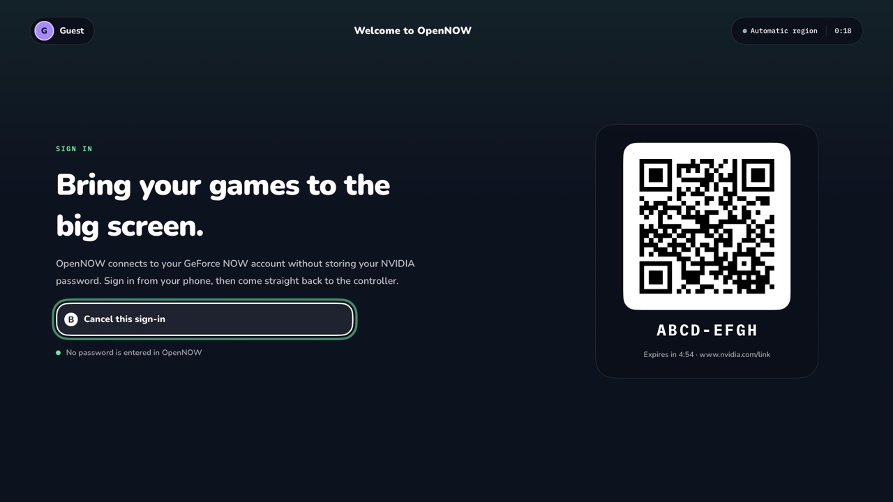
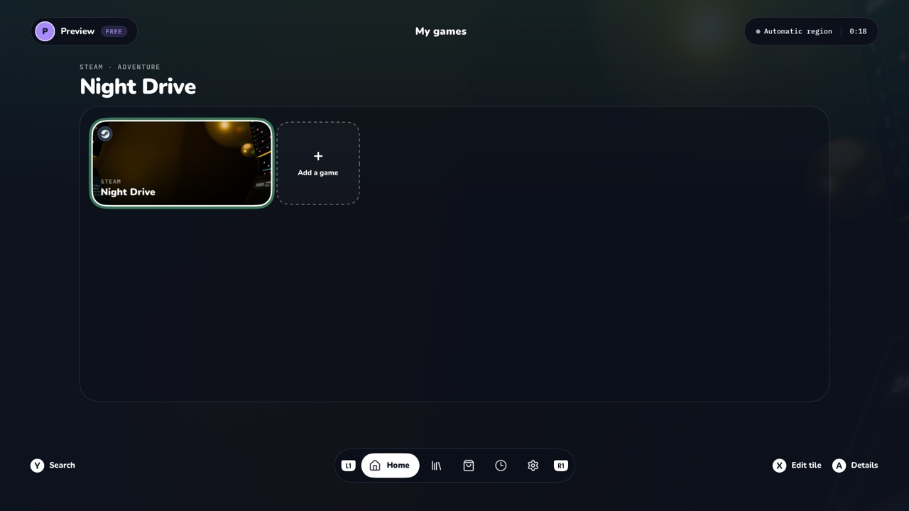
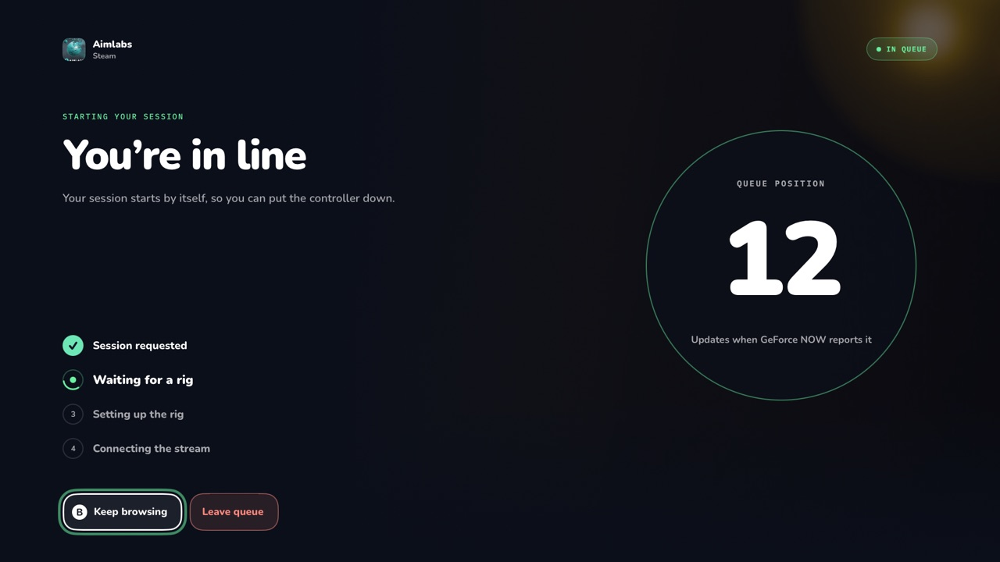
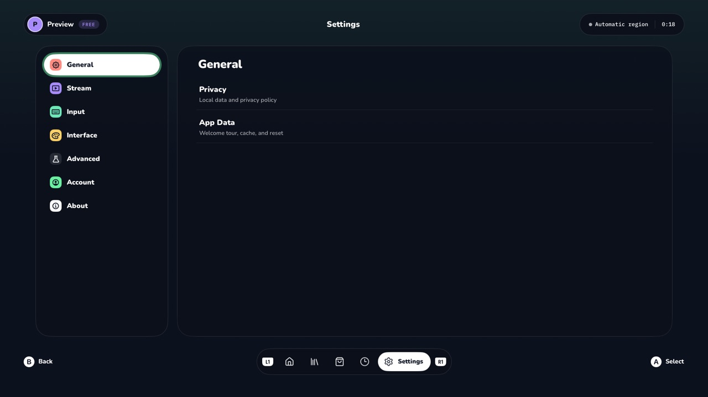

<h1 align="center">OpenNOW for Apple TV</h1>

<p align="center">
  
</p>

<p align="center">
  <strong>An unofficial GeForce NOW client for Apple TV. tvOS only.</strong>
</p>

<p align="center">
  <a href="https://github.com/Lacrowx/OpenNOW/releases">
    
  </a>
  <a href="https://github.com/Lacrowx/OpenNOW/actions/workflows/tvos-build.yml">
    
  </a>
  <a href="LICENSE">
    
  </a>
</p>

> [!NOTE]
> **This repository is for Apple TV only.** It is a fork of [OpenNOW](https://github.com/OpenCloudGaming/OpenNOW) that turns its iOS client into a native tvOS app. It is not an official OpenNOW release, and it is not maintained by the OpenNOW team.
>
> Looking for OpenNOW on Windows, macOS, Linux, iPhone, iPad or Android? Use the [official OpenNOW repository](https://github.com/OpenCloudGaming/OpenNOW) instead.

| | |
|---|---|
|  |  |
|  |  |

## What it does

- Plays your GeForce NOW library on the TV, with hardware video decoding.
- A console-style home screen made for the Siri Remote and game controllers. Sign in by scanning a QR code with your phone.
- 120 Hz at 1080p and 1440p, HDR, and 5.1 or 7.1 surround sound when your TV or receiver supports it.
- PlayStation, Xbox and other controllers, up to four players. DualSense pads show PlayStation button prompts and rumble.
- Your running and recently played games on the Apple TV Home screen (Top Shelf).

The full list, with known limits, is in the [Apple TV app README](ios/OpenNOWtvOS/README.md).

## What you need

- An **Apple TV** on **tvOS 27.1** or later.
- A **Mac** with **Xcode** (free in the Mac App Store).
- A free **Apple ID**. A paid developer account works too, but is not needed.
- A **game controller**. The Siri Remote can browse and sign in, but cannot play.
- Your own **GeForce NOW account**.

There is no App Store or TestFlight version. You install the app on your own Apple TV from your Mac. It takes about 20 minutes the first time.

## Install it (3 steps)

### 1. Set up Xcode

1. Install **Xcode** from the Mac App Store and open it once. When it asks which platforms to download, tick **tvOS**.
2. In Xcode, open **Xcode → Settings → Accounts**, press **+**, choose **Apple ID** and sign in.

### 2. Connect your Apple TV to the Mac

The Apple TV and the Mac must be on the same network.

1. On the Apple TV, open **Settings → Remotes and Devices → Remote App and Devices**. Leave this screen open.
2. On the Mac, in Xcode, open **Window → Devices and Simulators**. Your Apple TV appears on the left. Select it, press **Pair**, and type the code shown on the TV.
3. If the Apple TV later asks you to turn on **Developer Mode**, turn it on and let it restart.

### 3. Run the installer

Open the **Terminal** app on your Mac, paste these two lines and press Return:

```bash
git clone --depth 1 https://github.com/Lacrowx/OpenNOW.git OpenNOW-AppleTV && cd OpenNOW-AppleTV
```

```bash
sh ios/OpenNOWtvOS/BuildScripts/install.sh
```

The installer checks your setup and tells you what to fix if something is missing. It asks which Apple ID and which Apple TV to use, builds the app and opens it on your TV. If Homebrew tools are missing it installs them, or asks you to install [Homebrew](https://brew.sh) first.

That's it. OpenNOW is now on your Apple TV's Home screen.

### Keeping it running

- **Free Apple ID:** Apple lets apps you install yourself run for **7 days**. After that the app no longer opens. Run the installer again to reinstall it; your sign-in and settings stay.
- **Updating to a new version:** open Terminal and run:

  ```bash
  cd OpenNOW-AppleTV && git pull && sh ios/OpenNOWtvOS/BuildScripts/install.sh
  ```

### If something goes wrong

| What you see | What to do |
|---|---|
| "No Apple TV is paired with this Mac" | Do step 2 again. Keep the Apple TV awake and on the same network as the Mac. |
| "Xcode has no Apple account yet" | Sign in under **Xcode → Settings → Accounts**, then run the installer again. |
| The build fails with a signing or provisioning error | Check you are signed in under **Xcode → Settings → Accounts**. With a free Apple ID you can have at most 3 apps installed this way at a time; remove another one if needed. |
| You picked the wrong Apple ID or Apple TV | Delete `ios/OpenNOWtvOS/Signing.local.xcconfig` (Apple ID) or `ios/OpenNOWtvOS/BuildScripts/deploy.local` (Apple TV) and run the installer again. |
| Anything else | The full build log is `Build/tvos-device-build.log`. [Open an issue](https://github.com/Lacrowx/OpenNOW/issues) and attach it. |

<details>
<summary><strong>Other ways to install</strong></summary>

- **By hand in Xcode:** the step-by-step version is in the [Apple TV app README](ios/OpenNOWtvOS/README.md#install-on-your-apple-tv).
- **Unsigned IPA:** each [release](https://github.com/Lacrowx/OpenNOW/releases) has an unsigned `.ipa` for sideloading tools that sign it with your own Apple ID. It has not been tried with any sideloading tool yet, so the installer above is the tested way.

</details>

## Problems and ideas

Report problems with the Apple TV app [here](https://github.com/Lacrowx/OpenNOW/issues), not to the official OpenNOW project. Please include your Apple TV model, tvOS version and controller.

## About this repository

Everything for the Apple TV app is in [`ios/OpenNOWtvOS/`](ios/OpenNOWtvOS). It builds the shared sources of the official iOS client in [`ios/OpenNOWiOS/`](ios/OpenNOWiOS) for tvOS.

The other folders (`opennow-stable/`, `native/`, `locales/` and so on) are the official OpenNOW desktop app. They stay in this fork only so the Apple TV work can be sent back to the official project; they are not built, tested or supported here.

The goal is to get the Apple TV app into official OpenNOW.

## Legal

OpenNOW is an independent community project and is not affiliated with, endorsed by, or sponsored by NVIDIA or Apple. NVIDIA and GeForce NOW are trademarks of NVIDIA Corporation; Apple TV and tvOS are trademarks of Apple Inc. You must use your own GeForce NOW account.

OpenNOW is licensed under the [MIT License](LICENSE). Thanks to the [OpenNOW](https://github.com/OpenCloudGaming/OpenNOW) team and contributors for the client this port is built on.
