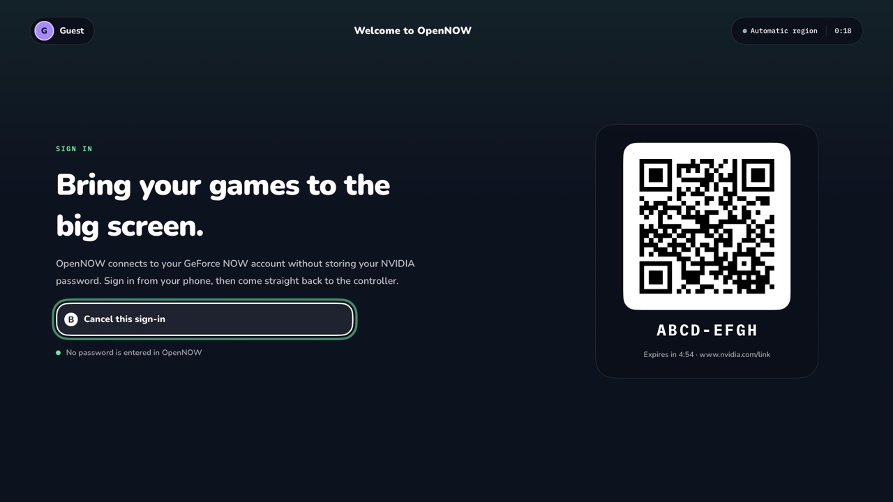
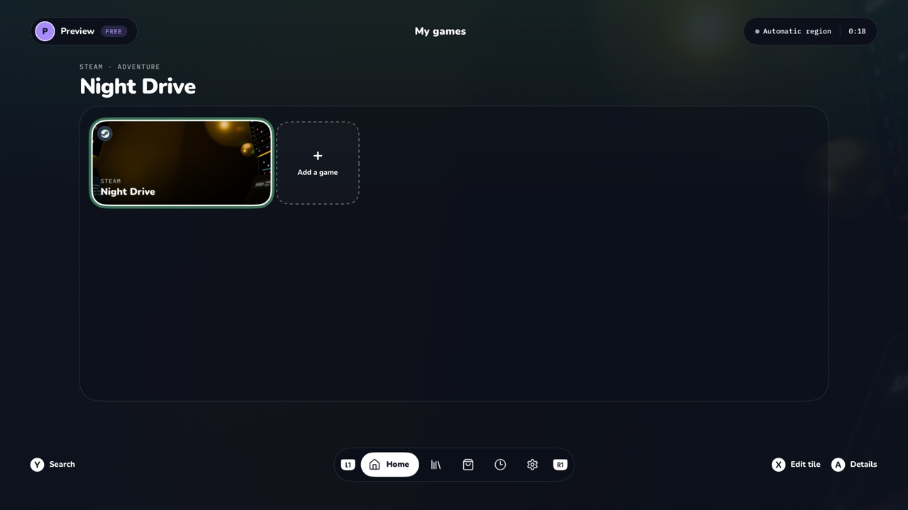
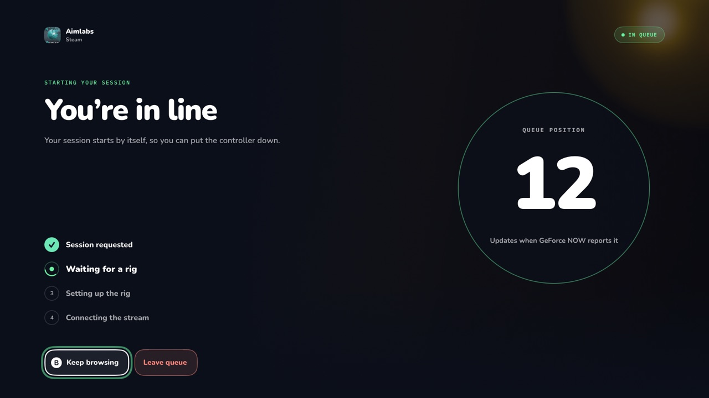
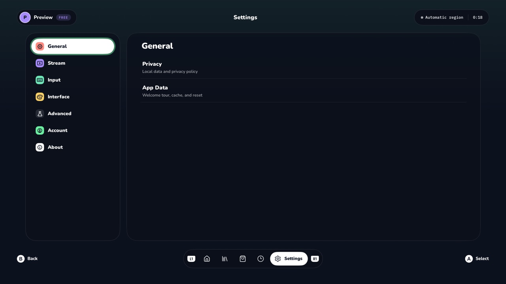

# OpenNOW for Apple TV

A tvOS build of the [iOS client](../OpenNOWiOS/README.md) for GeForce NOW on Apple TV. It compiles the iOS app's sources for tvOS, adds a console-style shell for the TV, and streams through the native NVST receiver.

> [!WARNING]
> Experimental and sideload only. There is no TestFlight or App Store build. The 120 Hz display switch uses a private tvOS API, so this build cannot be submitted to the App Store as it is.

| | |
|---|---|
|  |  |
|  |  |

Screenshots are from the tvOS simulator with sample data.

## What works

- **Streaming over native NVST.** tvOS has no WebRTC framework, so every stream uses the native NVST receiver with hardware decoding. Lost video packets are requested again from the seat instead of waiting for a keyframe.
- **Console shell.** Home, Store, Library, Sessions and Settings are laid out for the TV and driven by the remote or a controller. It is modelled on the Qt client's console screens and uses the same fonts and icons. Sign-in uses a device code with a QR code, and the first launch walks through setup.
- **Sessions.** Queue screen, launch conflicts, and rejoining or ending a session left over from an earlier run. A stream stays open for about 20 seconds after you press the TV/Home button, so coming straight back resumes the picture instead of reconnecting.
- **In-stream menu.** Hold Options for about a second during a stream, or press Back on the Siri Remote, for stream stats, trigger feels and ending the session.
- **120 Hz.** Apple TV 4K offers 120 Hz only below 4K (2560x1440 and 1920x1080). With a 120 fps stream the app switches the TV to a matching mode. You can also fix a mode in Settings, and choose what the TV does when you leave the app: return to its own mode at once, after a short break (the default, so a quick trip to the Home screen needs no mode switch), or keep the app's mode.
- **Surround sound.** With **Settings → Sound** on Automatic, a stream asks the seat for 5.1 or 7.1 when the TV or receiver reports that many channels, and stays stereo otherwise. The stream menu shows the format in use. If the output changes to a stereo one during a stream, surround is folded down to stereo.
- **DualSense.** When the seat supports it, a DualSense is sent to the seat as a DualShock 4 HID device, so games can show PlayStation button prompts, and rumble comes back to the pad. Other controllers are sent as Xbox-style pads.
  - On Steam games, prompts may stay Xbox until Steam's **Settings → Controller → PlayStation Controller Support** is set to **Not Enabled** on the host.
  - **DualSense trigger effects** (Settings → Input → Controller → Experimental) offers the pad to the seat as a DualSense. The seats tested so far refused it, and the pad falls back to the DualShock 4 route. There is a page there that plays each trigger effect locally.
  - **Trigger feels per game** (Off, Soft or Firm Resistance, Weapon Trigger, for L2 and R2) are chosen in the in-stream menu and remembered per game. They apply while the seat only knows the pad as a DualShock 4.
  - **Motion controls** (Settings → Input → Controller → Motion, off by default) send a PS5 controller's gyroscope and accelerometer to the game while the seat takes the pad as a PlayStation controller.
  - **Couch co-op.** Up to four controllers are sent to the seat, and each pad's player lights show its player number.
- **Top Shelf.** The row above OpenNOW on the Apple TV Home screen shows the game still running and your recently played games; selecting one starts or rejoins it. The app and its Top Shelf extension share an app group, which a free personal team can sign.
- **Idle streams** (Settings → Interface → Sessions & Queue, off by default). After 10 to 60 minutes without input, a one-minute "Still playing?" countdown appears; when it runs out the app leaves the stream or ends the session, as chosen.
- **Stream conditions.** The stream menu shows Wi-Fi or Ethernet, the audio output with its delay (Audio Output), and each controller's battery. A short notice points out Bluetooth or AirPlay sound that runs noticeably late, Wi-Fi that keeps losing packets, and a controller at 15% or 5%. The session report names the network, and a Wi-Fi session with loss suggests Ethernet.

## Known limits

- A game controller is needed to play. The Siri Remote can sign in, browse and open the in-stream menu, but it sends no input to the game.
- Only sessions with a native NVST (RTSPS) endpoint can stream.
- Free-tier accounts do not get the iOS app's server picker; a launch uses the automatic server choice.
- 4K at 120 fps is not possible: the Apple TV does not offer a 4K 120 Hz mode. A 4K 120 fps HEVC 10-bit 4:4:4 stream also decoded too slowly on an Apple TV 4K (4th generation) and skipped frames.
- iOS-only pages (touch controls, clipboard, web links, orientation) are left out on tvOS.
- Surround speaker placement was checked with level readouts on a TV without surround speakers, not by ear on a receiver. 7.1 was measured on a live stream; 5.1 follows the same pattern but was not measured.

## Requirements

- A Mac with Xcode that includes the tvOS 27.1 SDK or later.
- [XcodeGen](https://github.com/yonaskolb/XcodeGen) and CMake, for example `brew install xcodegen cmake`.
- An Apple TV on tvOS 27.1 or later, paired with Xcode.
- An Apple developer team. A free personal team works, but its apps expire after 7 days and need reinstalling.
- Your own GeForce NOW account.

## Build

Run these from the repository root.

1. Build the native protocol libraries (OpenSSL and usrsctp) for tvOS and the tvOS simulator. The script downloads the pinned OpenSSL and usrsctp sources, checks the OpenSSL hash and writes the frameworks to `ios/OpenNOWtvOS/Frameworks/`. You only need to do this once.

   ```sh
   python3 ios/OpenNOWtvOS/BuildScripts/build-native-protocol-libs-tvos.py
   ```

   Pass `--cmake /path/to/cmake` if CMake is not on your `PATH`.

2. Generate the Xcode project and build for a generic Apple TV, unsigned:

   ```sh
   sh ios/OpenNOWtvOS/BuildScripts/build.sh CODE_SIGNING_ALLOWED=NO
   ```

   The Xcode project is generated from `project.yml` and is not committed. The full log is in `Build/tvos-build.log`.

## Install on your Apple TV

The easy way: after pairing the Apple TV (step 1 below) and signing in under **Xcode → Settings → Accounts**, run

```sh
sh ios/OpenNOWtvOS/BuildScripts/install.sh
```

It checks Xcode and the tools, builds the native libraries if needed, asks for your team and Apple TV, writes the two local files from steps 2 and 3 for you, and runs `deploy.sh`. The [main README](../../README.md#install-it-3-steps) walks through it for beginners. The manual steps are:

1. Pair the Apple TV with your Mac. On the Apple TV, open **Settings → Remotes and Devices → Remote App and Devices**. In Xcode, open **Window → Devices and Simulators** and pair it.
2. Create `ios/OpenNOWtvOS/Signing.local.xcconfig` with your team and a bundle id of your own:

   ```
   DEVELOPMENT_TEAM = ABCDE12345
   OPENNOW_TVOS_BUNDLE_ID = com.example.opennow.tvos
   ```

3. Find the Apple TV's identifier with `xcrun devicectl list devices` and write it to `ios/OpenNOWtvOS/BuildScripts/deploy.local`:

   ```sh
   OPENNOW_TVOS_DEVICE=<identifier>
   ```

4. Build, install and launch:

   ```sh
   sh ios/OpenNOWtvOS/BuildScripts/deploy.sh
   ```

   This installs a Release build. Pass `--no-launch` to only install, or `--debug` for a Debug build (the launch-argument previews and the `[TVStream]` console output exist only there).

Both local files are ignored by Git. You can also open the generated `ios/OpenNOWtvOS/OpenNOWtvOS.xcodeproj` in Xcode and run the `OpenNOWtvOS` scheme from there.

## Package an unsigned IPA

```sh
sh ios/OpenNOWtvOS/BuildScripts/package-ipa.sh
```

This writes `Build/OpenNOW-tvOS-<version>-unsigned.ipa`, an unsigned Release build for sideloading tools that sign it with your own Apple account. It has not been tried with any sideloading tool yet.

## Report a problem

This port is not an official OpenNOW release, so please report problems with it at [Lacrowx/OpenNOW](https://github.com/Lacrowx/OpenNOW/issues), not to the upstream project. The in-app "Report a Problem" form of the iOS client is left out on Apple TV for the same reason.

## Tests

The `OpenNOWtvOS` scheme runs the iOS project's NVST protocol tests against the tvOS build, plus the tests for the tvOS-only sources:

```sh
xcodebuild test -project ios/OpenNOWtvOS/OpenNOWtvOS.xcodeproj -scheme OpenNOWtvOS \
  -destination 'platform=tvOS Simulator,name=Apple TV 4K (4th generation)' \
  -derivedDataPath Build/DerivedData-tvOS
```

## Layout

```text
ios/OpenNOWtvOS/
├── project.yml        XcodeGen spec: builds ../OpenNOWiOS/OpenNOWiOS sources plus Sources/ for tvOS
├── Sources/           tvOS-only code: stream coordinator and view, display modes, console shell
├── TopShelf/          Top Shelf extension (recent and running games)
├── Shared/            code built into both the app and the Top Shelf extension
├── Tests/             tests for the tvOS-only code
├── Resources/         fonts (SIL Open Font License 1.1, license texts alongside)
├── TVAssets.xcassets  app icon and top shelf image
├── Screenshots/       the images in this README
├── Signing.xcconfig   signing defaults; your values go in Signing.local.xcconfig
└── BuildScripts/      native library build, install.sh, build.sh, deploy.sh and package-ipa.sh
```

Changes to the shared iOS sources are behind `#if os(tvOS)` or its negation, so the iOS build is unchanged.
